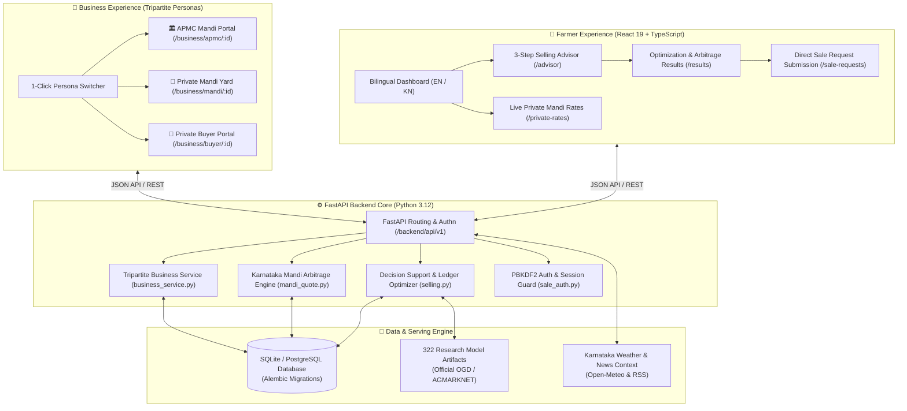
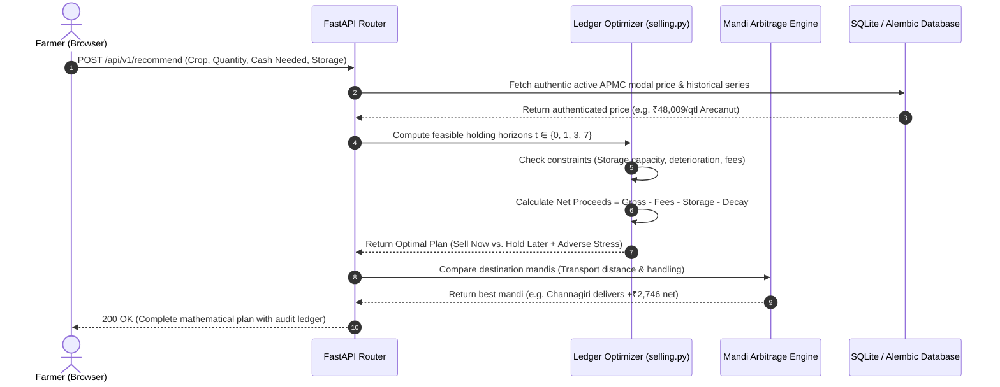

# SAMAY (ಸಮಯ) · Agricultural Decision Support & Trading Network

> **"The Right Time to Decide — With Uncertainty Left In."**  
> Cash-aware sell-or-hold decision support, inter-mandi spatial arbitrage, and a unified tripartite marketplace (APMC Mandis, Private Mandis, and Private Buyers) for Karnataka agriculture.

[](https://fastapi.tiangolo.com)
[](https://react.dev)
[](https://www.typescriptlang.org)
[](https://vitejs.dev)
[](https://www.python.org)
[]()
[](file:///tests)
[](file:///frontend)

---

## 📑 Table of Contents
1. [Executive Overview](#-executive-overview)
2. [Core Innovations & Architecture](#-core-innovations--architecture)
   - [System Architecture Flow](#system-architecture-flow)
   - [Frontend Architecture](#frontend-architecture)
   - [Backend Architecture & Optimization Engine](#backend-architecture--optimization-engine)
3. [User Modes & Personas](#-user-modes--personas)
   - [Farmer Mode (Bilingual Journey)](#1-farmer-mode-bilingual-journey)
   - [Business Mode (Tripartite Persona Network)](#2-business-mode-tripartite-persona-network)
4. [Mathematical Formulation](#-mathematical-formulation)
   - [Net Proceeds Ledger Equation](#net-proceeds-ledger-equation)
   - [Risk-Adjusted Decision Rule](#risk-adjusted-decision-rule)
   - [Mandi Arbitrage & Spatial Optimization](#mandi-arbitrage--spatial-optimization)
5. [Directory Layout](#-directory-layout)
6. [Local Development Setup](#-local-development-setup)
7. [Cloud & Vercel Deployment](#-cloud--vercel-deployment)
8. [API Endpoints Reference](#-api-endpoints-reference)
9. [Testing & Verification](#-testing--verification)

---

## 🌟 Executive Overview

Indian agricultural marketing places tremendous economic risk on smallholder farmers. When produce is harvested, farmers face a high-stakes question:
* **"Should I sell today at the local APMC yard, or store produce for higher anticipated prices?"**
* **"Can I afford storage and shrinkage fees while meeting immediate debt and household cash obligations?"**
* **"Is it worth transporting produce to a neighboring district mandi for a higher quoted price?"**

Existing agricultural apps typically offer black-box machine learning predictions with unvalidated claims of profit, ignoring physical storage constraints, daily warehousing fees, post-harvest quality decay, and transportation logistics.

**SAMAY (Colossus 3.0)** provides honest, constraint-governed decision support. It treats marketing as a **multi-horizon constrained optimization problem** solved using exact `Decimal` arithmetic:
- **Mandatory Cash Protection:** Hard cash requirements are **never relaxed**. Immediate sales are enforced if holding risks a liquidity shortfall.
- **Physical Feasibility First:** If a farmer specifies zero storage capacity or perishable shelf-life expiry, holding is strictly barred from recommendation.
- **Transparent Uncertainty:** Instead of point forecasts, SAMAY models downside and adverse price stress scenarios.
- **Inter-Mandi Arbitrage Engine:** Evaluates distance, truck freight, handling, and market fees across major Karnataka APMCs (e.g., Kolar, Shivamogga, Channagiri, Hubballi, Tiptur, Bengaluru).
- **Direct Marketplace Connection:** Seamlessly connects farmers to three distinct business operators: **APMC Government Mandis**, **Licensed Private Mandis**, and **Direct Private Buyers / Processors**.

---

## 🏗 Core Innovations & Architecture

### System Architecture Flow



---

### Frontend Architecture

* **Framework & Build:** React 19 + Vite 8.3 + TypeScript 5.7.
* **Styling & Icons:** Modern CSS custom properties with responsive flexbox/grid layout and Lucide React icons.
* **Dual Localized UI:** Built with standard English and Kannada (`kn-IN`) locales (`src/locales/kn.ts`, `src/locales/sale-kn.ts`). Every financial ledger item, badge, and date renders natively in Kannada with localized currency formatting.
* **Adaptive Navigation Shell:** Dynamically switches sidebar navigation and breadcrumbs between **Farmer Workspace** and **Business Workspace**.
* **Zero-Flicker Background Authentication:** `business-context.tsx` provides seamless 1-click session healing, auto-recovering lost or cold-started serverless tokens without interrupting user workflows.

```
frontend/
├── src/
│   ├── App.tsx                 # Root application shell, navigation, and SPA router
│   ├── AdvisorPage.tsx         # 3-Step interactive Selling Advisor wizard
│   ├── Results.tsx             # Recommendation results view with exportable ledger
│   ├── DecisionPanel.tsx       # Hold vs. Sell card, economics stats, and attribution
│   ├── SalePages.tsx           # APMC Mandi request workflow, notifications, operator portal
│   ├── BusinessPages.tsx       # Private business registrations and admin approval queue
│   ├── BusinessPurchasing.tsx  # Private buyer purchasing portal, offer creation, lot bookings
│   ├── PrivateRatesPage.tsx    # Live comparison table of published private buying rates
│   ├── MarketPages.tsx         # Live market overview, causal forecasts, model transparency
│   ├── business-context.tsx    # Role switching context, workspace state, persona selection
│   ├── sale-api.ts             # Fetch client with CSRF protection, credentials, error typing
│   └── locales/                # Exhaustive Kannada translation dictionaries
```

---

### Backend Architecture & Optimization Engine



* **FastAPI Application (`backend/app/main.py`):** High-performance ASGI interface utilizing Pydantic v2 schemas for strict request/response boundary contracts.
* **Exact Mathematical Precision (`backend/app/selling.py`):** Uses Python's native `Decimal` engine to guarantee that financial settlement, market cess, unloading fees, and transport costs suffer zero floating-point drift.
* **Deterministic Decision Logic (`backend/app/decision_support.py`):** Explicitly separates planning scenarios from guaranteed outcomes. Generates audited reason codes (`mandatory_cash_and_storage_constraints_satisfied`, `holding_cannot_be_assessed_without_future_scenarios`).
* **Multi-Tier Mandi Pricing (`backend/app/mandi_quote.py`):** Automatically fallbacks across authenticated district observations, APMC modal baseline rates, and published private offers.

---

## 👥 User Modes & Personas

### 1. Farmer Mode (Bilingual Journey)

Designed for simplicity, speed, and zero financial ambiguity:

1. **Live Market Discovery:** Select from 5 major Karnataka commodities:
   - 🍅 **Tomato** · Kolar APMC
   - 🌰 **Arecanut** · Shivamogga Mandi
   - 🧅 **Onion** · Hubballi APMC
   - 🥥 **Copra** · Tiptur APMC
   - 🥔 **Potato** · Bengaluru APMC
2. **The 3-Step Selling Advisor (`/advisor`):**
   - *Step 1: Harvest & Cash Needs:* Enter harvest quantity (quintals) and mandatory immediate cash obligations (INR).
   - *Step 2: Storage Availability:* Specify if covered on-farm storage is available, capacity ceiling, and daily storage cost per quintal.
   - *Step 3: Risk & Adverse Stress:* Configure tolerance against adverse price drops (e.g. 10% downside vs. 20% adverse stress).
3. **Decision & Arbitrage Output (`/results`):**
   - Clear verbal verdict: *"Selling Today Recommended"* or *"Holding Recommended: +₹X Projected Gain"*.
   - Break-even future price requirement (the exact price per quintal needed later to beat selling today).
   - Mandi Arbitrage comparison identifying whether taking crops to an alternate APMC pays for its own transport.
4. **Direct Request Submission (`/sale-requests`):**
   - Submit intent-to-sell requests directly to the preferred mandi yard or private buyer.
   - Real-time in-app delivery receipts and notification inbox.

---

### 2. Business Mode (Tripartite Persona Network)

SAMAY unifies Karnataka's distinct agricultural buying channels into one intuitive interface with a top-bar **1-Click Persona Switcher**:

```
[ Business Mode ] ▾
  ├── 🏛️ APMC Mandi (Kolar APMC Market Yard)
  ├── 🏬 Private Mandi (Monish MR Private Mandi Yard)
  └── 💼 Private Buyer (Monish MR Direct Processor / Buyer)
```

| Persona | Operator Type | Key Capabilities |
| :--- | :--- | :--- |
| **🏛️ APMC Mandi** | Government Regulated Market Yard | • View all incoming farmer lot requests submitted from the advisor<br>• Dispatch counteroffers and schedule vehicle arrival dates<br>• Record arrived produce and verify weight at official weighbridges<br>• Log completed physical auction sales |
| **🏬 Private Mandi** | Licensed Private Market Yard | • Set custom operating hours and daily intake capacity<br>• Publish multi-crop daily buying rates visible in farmer mode<br>• Accept farmer delivery appointments and schedule yard logistics<br>• Maintain verified license registration with admin approval |
| **💼 Private Buyer** | Direct Processor / Exporter / Bulk Buyer | • **Create Buying Offers:** Publish multi-crop buying rates with quality standards<br>• **Lot Reservation Engine:** Incoming requests reserve available quantity to prevent over-commitment<br>• **Counter-offers:** Negotiate arrival dates and prices per quintal<br>• **Analytics Dashboard:** Monitor total committed volume, upcoming arrivals, and purchase spend |

---

## 📐 Mathematical Formulation

### Net Proceeds Ledger Equation

For an immediate sale at day $t = 0$:
$$\text{Net}_0 = Q \times P_0 - \text{Comm}(Q, P_0) - \text{Fee}(Q, P_0) - \text{Trans}(Q) - \text{Hand}(Q)$$

For holding $Q_h$ quintals until horizon $t > 0$ with immediate cash sale $Q_s = Q - Q_h$:
$$\text{Net}_t = \text{Net}_0(Q_s) + \text{LaterNet}_t(Q_h)$$

Where:
$$\text{LaterNet}_t(Q_h) = \left(Q_h \times (1 - \delta \cdot t)\right) \times P_t - \text{Storage}(Q_h, t) - \text{Comm}_t - \text{Fee}_t - \text{Trans}_t - \text{Hand}_t$$
* $Q$: Total harvest quantity (quintals).
* $P_0, P_t$: Today's observed modal price and future projected price ($\text{INR/qtl}$).
* $\delta$: Daily post-harvest deterioration / shrinkage rate.
* $\text{Storage}(Q_h, t) = Q_h \times c_s \times t$, with daily storage rate $c_s$.
* $\text{Comm}, \text{Fee}, \text{Trans}, \text{Hand}$: Commission, statutory APMC market fee, road transport, and unloading handling costs.

### Risk-Adjusted Decision Rule

A holding plan is eligible for recommendation **if and only if**:
1. **Cash Obligation Met:** $\text{CashToday} \ge \text{MandatoryCashNeeded}$.
2. **Physical Storage Feasible:** $Q_h \le \text{StorageCapacity}$.
3. **Risk-Adjusted Superiority:**
   $$\text{Objective}(t) = \text{CentralNet}_t - \lambda \cdot (\text{CentralNet}_t - \text{AdverseNet}_t) > \text{Net}_0$$
   *(where $\lambda$ represents the farmer's stress aversion penalty).*

### Mandi Arbitrage & Spatial Optimization

For an alternate mandi $m$ at distance $D_m$:
$$\text{Arbitrage Gain}_m = \left(Q \times P_m - \text{Freight}(D_m, Q) - \text{Handling}_m\right) - \text{Net}_{\text{local}}$$
If $\text{Arbitrage Gain}_m > 0$, SAMAY highlights the route and displays net gain after deducting all travel and logistics expenses.

---

## 📁 Directory Layout

```text
samay_colossus/
├── api/
│   └── index.py                     # Vercel serverless function entry point
├── backend/
│   ├── alembic/                     # Database version migration scripts
│   ├── app/
│   │   ├── main.py                  # FastAPI application factory and lifespan setup
│   │   ├── config.py                # Pydantic environment settings configuration
│   │   ├── db.py                    # SQLAlchemy engine and connection sessionmaker
│   │   ├── db_migration.py          # Auto-upgrade migrations for local & cloud DBs
│   │   ├── models.py                # Core database ORM entities
│   │   ├── sale_models.py           # Mandi workflow, user, and notification tables
│   │   ├── business_models.py       # Private marketplace, workspaces, RBAC models
│   │   ├── purchase_models.py       # Private purchasing, offers, reservations models
│   │   ├── selling.py               # Mathematical optimization and Decimal ledgers
│   │   ├── decision_support.py      # Hold vs. sell decision rule evaluation
│   │   ├── mandi_arbitrage.py       # Road distance and spatial price arbitrage engine
│   │   ├── mandi_quote.py           # Multi-tier fallback price quote resolver
│   │   ├── business_service.py      # Business workspaces and persona switching
│   │   ├── purchase_service.py      # Lot reserving, offer lifecycle, and confirmations
│   │   └── sale_auth.py             # Server sessions, PBKDF2 hashing, and CSRF guard
│   └── requirements-lock.txt        # Pinned backend dependencies
├── data/
│   ├── prepared/                    # Portable authentic market database & SHA-256 manifest
│   └── raw/                         # Official OGD & AGMARKNET source archives
├── frontend/
│   ├── src/                         # React 19 application components & contexts
│   ├── dist/                        # Compiled production frontend build
│   └── package.json                 # Node dependencies and build scripts
├── models/                          # 322 frozen research model artifacts
├── reports/                         # Pre-computed verification and evaluation reports
├── scripts/
│   ├── setup_local.py               # Unified environment installer (.venv + npm)
│   ├── start_local.py               # Local daemon launcher (ports 8010 / 5173)
│   ├── seed_three_personas.py       # Automated persona and market price seeder
│   └── verify_release.py            # Comprehensive release verification harness
├── tests/                           # 202 backend pytest suites
├── main.py                          # Root ASGI entrypoint for Vercel auto-detection
├── server.py                        # Production standalone runner with SPA fallback
├── vercel.json                      # Vercel cloud deployment specification
└── pytest.ini                       # Pytest paths and warning configurations
```

---

## 💻 Local Development Setup

### Prerequisites
* **Python:** `3.11+` (Python `3.12` recommended)
* **Node.js:** `20.0+` (Node `22` or `24` recommended) & `npm`
* **Git**

### 1-Step Automated Launch
Open PowerShell in the repository root:

```powershell
# 1. Install Python virtualenv and frontend dependencies
python scripts/setup_local.py

# 2. Start both Frontend and Backend concurrently
.\.venv\Scripts\python.exe scripts/start_local.py --enable-research
```

### Access URLs:
* **Frontend Application:** [http://127.0.0.1:5173](http://127.0.0.1:5173)
* **Backend Swagger API Docs:** [http://127.0.0.1:8010/docs](http://127.0.0.1:8010/docs)
* **Health Check:** [http://127.0.0.1:8010/api/health](http://127.0.0.1:8010/api/health)

### Pre-Configured Test Credentials:
* **Demo User:** `Monish MR`
* **Email:** `monishmr1986@gmail.com`
* **Password:** `monish1234`
*(Or use the **`⚡ 1-Click Sign In`** button on any login screen)*

---

## ☁️ Cloud & Vercel Deployment

SAMAY is pre-configured for zero-error deployments on **Vercel**:

1. **Push to GitHub:**
   ```bash
   git push origin main
   ```
2. **Import into Vercel:**
   * Framework Preset: Select **FastAPI** (or let Vercel auto-detect from `main.py` / `requirements.txt`).
   * Root Directory: `./`
3. **Environment Variables (Optional for Persistence):**
   * `SAMAY_PERSISTENT_DATABASE_URL`: Provide a remote PostgreSQL or Turso SQLite URL for permanent cross-instance persistence.
   * `SAMAY_MARKETPLACE_ENABLED`: Defaults to `true`.
4. **Vercel Architectural Features:**
   * **Full SPA Fallback:** Client-side React Router navigation (e.g. `/business`, `/advisor`, `/sale-requests`) renders without 404s.
   * **Automated Instance Seeding:** Fresh serverless runtimes automatically seed all 3 personas and active observations.
   * **Self-Healing Session Recovery:** Polling mechanisms transparently recover authentication during serverless cold starts.

---

## 🔌 API Endpoints Reference

| Method | Endpoint | Description | Auth Required |
| :--- | :--- | :--- | :---: |
| `GET` | `/api/health` | Service liveness and version check | No |
| `POST` | `/api/v1/recommend` | Run constrained sell-or-hold optimization engine | No |
| `POST` | `/api/v1/auth/demo-login` | 1-Click demo authentication for test user | No |
| `POST` | `/api/v1/auth/login` | Authenticate with email and password | No |
| `GET` | `/api/v1/auth/me` | Fetch active user profile and roles | Yes |
| `GET` | `/api/v1/business/roles` | Retrieve authorized business workspaces | Yes |
| `POST` | `/api/v1/business/active-role` | Switch persona (APMC Mandi, Private Mandi, Buyer) | Yes |
| `GET` | `/api/v1/business/offers` | List public and owner buying offers | Optional |
| `POST` | `/api/v1/business/offers` | Create new private commodity buying offer | Yes |
| `POST` | `/api/v1/private-purchases/offers/:id/requests` | Submit farmer lot sale request with quantity reservation | Yes |
| `GET` | `/api/v1/notifications` | Fetch localized in-app notifications | Yes |
| `GET` | `/api/v1/notifications/unread-count` | Real-time count of unread messages | Yes |

---

## 🧪 Testing & Verification

SAMAY enforces strict quality and correctness standards across the entire stack:

```powershell
# Run all 202 backend tests (Pytest)
.\.venv\Scripts\python.exe -m pytest tests -q

# Run all 45 frontend tests (Vitest)
cd frontend
npm test

# Run TypeScript typecheck
npm run typecheck

# Run backend code linter (Ruff)
cd ..
.\.venv\Scripts\python.exe -m ruff check backend scripts tests
```

---

## ⚖️ License & Provenance Notice

* **Market Observations:** Sourced from official Open Government Data (OGD India / AGMARKNET) records covering authenticated Karnataka APMC yards.
* **Disclaimer:** Mandi prices are wholesale auction observations, not guaranteed farmer realizations. Future price forecasts represent conditional research scenarios. Physical crop sales and financial settlements occur directly between farmers and licensed market operators outside SAMAY.
