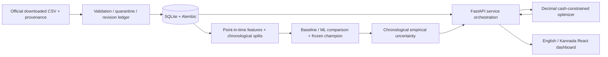

# SAMAY: technical briefing for judges

> Current update: the official acquisition succeeded with 1,943 records and six
> saved retrospective baseline champions. MODEL-RESULTS.md has actual computed
> errors and failures; ACQUISITION.md has original hashes. Zero-data statements
> below describe the earlier release. Original revision timing remains unverified,
> so these are research estimates, not validated live forecasting performance.

Team Resonance · COLOSSUS 3.0. SAMAY helps reason about cash, net proceeds and
physical holding risks. **Today the local engineering system works, but the
authentic-data/model demonstration is blocked.** We do not claim market accuracy
or profit uplift without genuine out-of-sample observations.

## Architecture

Handlers delegate to tested domain services. OpenAPI generates TypeScript
contracts. Source dates, canonical series, model versions, freshness, warnings,
assumptions and anonymous history IDs trace each result. Forecast artifacts are
explicitly registered, never selected by whichever test result looks best.

## Real data provenance

Target scope: Karnataka / Kolar / Kolar APMC / Tomato with one consistent variety
and grade. Intended official sources are [OGD](https://www.data.gov.in/resource/variety-wise-daily-market-prices-data-commodity)
and [AGMARKNET](https://agmarknet.gov.in). During acquisition attempts, OGD was
unusable/timed out and AGMARKNET returned 403. There are **0 authentic official
observations** in the workspace. Three fixture rows are excluded from default APIs.
No undocumented endpoint, key, dataset UUID or historical response was invented.

The importer validates an operator-attested official source manifest and immutable
local file hashes. A government hostname and local SHA256 prove neither independent
publisher authenticity nor original historical publication timing. Both limitations
are disclosed. Original fetch times are preserved; later revisions enter only
after availability. Missing dates are never fabricated.

## Forecasting evidence

All 1/3/7-calendar-day effective training/validation counts currently equal zero.
No champion, real MAE/RMSE/sMAPE/WAPE, interval coverage or final test exists.
EVALUATION contains the actual commands and unavailable results.

The implemented comparison uses identical causal rows and chronological CV folds
for naive, rolling mean/median, supported seasonal naive, ridge, histogram boosting
and optional sufficiently sampled LightGBM. Validation MAE leads selection;
stability and optimistic downside errors help break ties. Advanced models must
beat all core baselines consistently before promotion. Final evaluation is reserved
and consumed once, after selection is frozen. Uncertainty uses prior chronological
residual blocks, with observed coverage and width; dependence prevents any blanket
coverage guarantee. Sparse/stale/drifting inputs downgrade or disable output.

## Why the optimizer is differentiated

A price forecast alone cannot decide how much to sell. SAMAY first enforces
immediate **net cash**, storage capacity, crop limits, transaction lots and rounding.
It enumerates sell/hold quantities and permitted dates, accounting for separate
fixed and variable sale costs, fees, compounded quantity loss and storage-payment
timing. It compares downside/central/upper scenarios and a disclosed adverse stress
with selling everything now. Deterministic risk preferences are utility weights,
not invented probabilities. Plans expose settlement ledgers and break-even prices.

Missing/unreliable forecasts cannot produce a confident hold recommendation.
Infeasible cash needs remain infeasible. English and Kannada display one backend
calculation. The explanation generator fills templates with returned numbers;
it does not ask an LLM to calculate finances.

The live browser example is deliberately quote-based: 20 qtl × ₹1,000 less ₹1,000
commission and ₹300 transport = ₹18,700. Zero storage means hold 0. This verifies
the service, not government price quality or farmer profit.

## Security and deployment

Strict schemas/units/dates, origin allowlist, safe structured logs, generated
request IDs, minimal anonymous local history, server-only artifact paths and hash
checks. No identity/location/contact details required. Secret/database/data/model
files are ignored by Git/Docker builds. Pickles must be trusted local artifacts;
hash checks do not make arbitrary pickles safe. Public auth/rate limiting and
multi-tenant operation are not implemented. Docker is prepared, untested; no
external hosting is claimed. Development dependency advisories remain disclosed.

## Hard questions and honest answers

| Question | Answer |
| --- | --- |
| Is this real live government data? | No real data is prepared in this workspace. The UI shows the actual unavailable state. |
| What is your accuracy? | Unavailable; no valid held-out market samples. Fixture tests cannot answer this. |
| Why not always LightGBM? | Promotion requires actual chronological improvement. There is no evidence to prefer it here. |
| Does a higher predicted price imply profit? | No. Costs, quantity loss, cash and downside can make immediate sale preferable. |
| Is the 90% band a 90% chance of this farmer's price? | No. It is a nominal empirical modal-price band; transaction uncertainty and future coverage differ. |
| Can a large historical download solve the data issue? | Not by itself. Historical availability/revisions require genuine dated vintages; do not backdate imports. |
| Does the backtest prove gains? | No current real decisions are scorable. It emits null outcomes; future studies also need transaction-cost/realization evidence. |
| Does it work offline? | Local services/UI do, once dependencies/artifacts exist. Authentic offline forecast acceptance is still blocked. |
| Is Kannada verified by farmers? | Implemented and numerically tested; local language/domain validation remains to be done. |
| What next? | Acquire verified timestamped source archives, collect prospectively if needed, reserve chronological evaluation, train/select honestly, calibrate and deploy explicit artifacts. |
