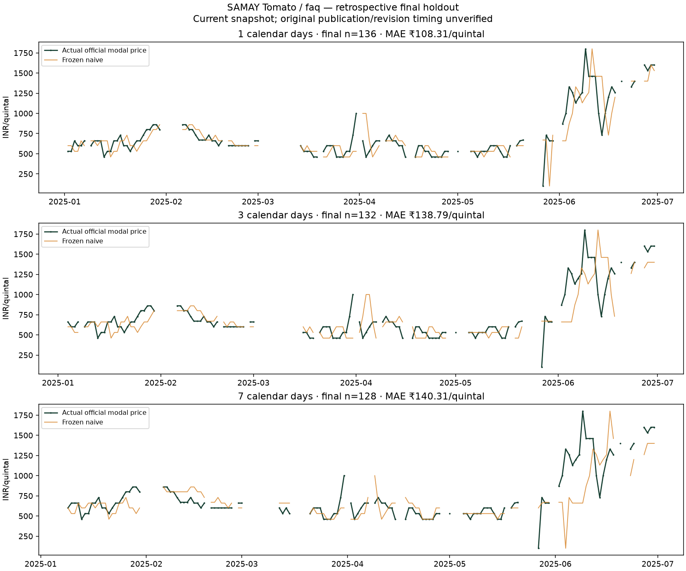
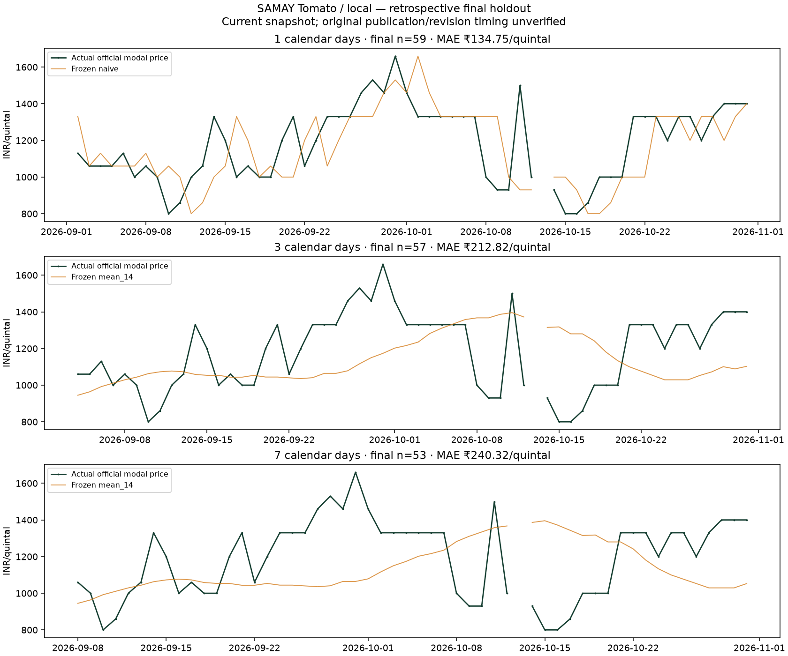

# Actual SAMAY model results · 2026-11-04

**Retrospective snapshot research only; not verified live/as-of performance.**

Six genuine government CSV exports were downloaded through the official AGMARKNET website with CAPTCHA authorization. Original bytes, actual fetch times and hashes are retained. No fetch timestamp was backdated.

1,943 official records were imported with zero quarantined, duplicate or revised rows in these six batches. Original source grades differ: 1,562 Tomato/FAQ, 371 Tomato/Local, 5 Tomato/Grade Range-1, 3 Hybrid/FAQ and 2 Hybrid/Local. Grades and varieties were not merged.

FAQ ends 2025-06-30; Local begins 2025-07-03. That source metadata break required separate study windows before fitting. Counts/date coverage, rather than future price outcomes, determined those windows.

All saved champions are baselines. Ridge, histogram boosting and (for the broad FAQ study) LightGBM were actually fitted/compared. They did not satisfy the predeclared baseline promotion policy.

There is no defensible single price-regression 'accuracy percentage'. MAE/RMSE are INR/quintal errors; WAPE/sMAPE are percentage errors. Lower is better. Direction accuracy includes unchanged-price ties. Do not convert 100−WAPE into a claimed accuracy.

## Tomato / faq

Train: **2021-01-01–2023-12-31**. Selection validation: **2024-01-01–2024-12-31**. Final holdout: **2025-01-01–2025-06-30**.

Run: `models/research/research-snapshot-v1-6dd9ea73854cc050`. Three chronological rolling-origin folds inside training; model choice uses development only. All selections were frozen before final rows were loaded. Final holdout was consumed once; no tuning or champion replacement used final errors.

| Horizon | Frozen champion | Train n | Validation n | Final n | MAE | Naive MAE | RMSE | sMAPE % | WAPE % | Direction % |
| --- | --- | ---: | ---: | ---: | ---: | ---: | ---: | ---: | ---: | ---: |
| 1d | naive | 1050 | 341 | 136 | 108.31 | 108.31 | 174.17 | 15.34 | 14.87 | 22.79 |
| 3d | naive | 1048 | 339 | 132 | 138.79 | 138.79 | 209.92 | 18.56 | 18.91 | 20.45 |
| 7d | naive | 1044 | 335 | 128 | 140.31 | 140.31 | 235.94 | 18.13 | 18.98 | 21.09 |

### Actual candidate comparisons used for selection

| Horizon | Candidate | CV mean MAE | CV MAE std | Selection-validation MAE | Promotable advanced candidate |
| --- | --- | ---: | ---: | ---: | --- |
| 1d | naive | 203.84 | 74.90 | 209.23 | core baseline |
| 1d | mean_14 | 377.82 | 173.82 | 343.11 | core baseline |
| 1d | median_14 | 379.76 | 166.81 | 362.13 | core baseline |
| 1d | ridge_1 | 220.30 | 58.56 | 296.16 | False |
| 1d | ridge_10 | 212.65 | 60.89 | 288.15 | False |
| 1d | ridge_100 | 237.85 | 73.15 | 298.04 | False |
| 1d | hist_gradient_boosting | 375.06 | 268.92 | 253.87 | False |
| 1d | seasonal_naive | 352.23 | 140.82 | 355.96 | False |
| 1d | lightgbm | 369.71 | 264.68 | 253.82 | False |
| 3d | naive | 271.42 | 104.24 | 277.96 | core baseline |
| 3d | mean_14 | 434.78 | 196.99 | 394.90 | core baseline |
| 3d | median_14 | 434.21 | 188.82 | 410.23 | core baseline |
| 3d | ridge_1 | 298.18 | 71.01 | 429.80 | False |
| 3d | ridge_10 | 278.99 | 72.86 | 409.05 | False |
| 3d | ridge_100 | 295.77 | 85.09 | 391.82 | False |
| 3d | hist_gradient_boosting | 449.52 | 266.88 | 313.93 | False |
| 3d | seasonal_naive | 353.71 | 145.52 | 365.67 | False |
| 3d | lightgbm | 453.41 | 269.30 | 323.93 | False |
| 7d | naive | 371.50 | 145.01 | 400.30 | core baseline |
| 7d | mean_14 | 535.55 | 243.51 | 476.68 | core baseline |
| 7d | median_14 | 533.42 | 233.36 | 484.80 | core baseline |
| 7d | ridge_1 | 332.81 | 50.14 | 562.24 | False |
| 7d | ridge_10 | 321.74 | 62.75 | 533.24 | False |
| 7d | ridge_100 | 344.97 | 83.82 | 488.40 | False |
| 7d | hist_gradient_boosting | 549.81 | 236.62 | 434.62 | False |
| 7d | seasonal_naive | 511.90 | 196.86 | 516.13 | False |
| 7d | lightgbm | 536.42 | 230.77 | 440.14 | False |



Full metrics, all fold sizes, exclusions and runtime: `../models/research/research-snapshot-v1-6dd9ea73854cc050/comparison.json`. Saved frozen artifacts: `champion-1d`, `champion-3d`, `champion-7d`. Each contains model.pkl, feature schema, actual training timestamp, source fingerprint and research-only metadata.

## Tomato / local

Train: **2025-07-03–2026-06-30**. Selection validation: **2026-07-01–2026-08-31**. Final holdout: **2026-09-01–2026-10-31**.

Run: `models/research/research-snapshot-v1-bf5682f4a2bfbde9`. Three chronological rolling-origin folds inside training; model choice uses development only. All selections were frozen before final rows were loaded. Final holdout was consumed once; no tuning or champion replacement used final errors.

| Horizon | Frozen champion | Train n | Validation n | Final n | MAE | Naive MAE | RMSE | sMAPE % | WAPE % | Direction % |
| --- | --- | ---: | ---: | ---: | ---: | ---: | ---: | ---: | ---: | ---: |
| 1d | naive | 212 | 60 | 59 | 134.75 | 134.75 | 184.25 | 11.89 | 11.44 | 27.12 |
| 3d | mean_14 | 210 | 58 | 57 | 212.82 | 174.74 | 256.50 | 18.29 | 18.03 | 47.37 |
| 7d | mean_14 | 212 | 54 | 53 | 240.32 | 240.57 | 287.23 | 20.45 | 20.21 | 58.49 |

### Actual candidate comparisons used for selection

| Horizon | Candidate | CV mean MAE | CV MAE std | Selection-validation MAE | Promotable advanced candidate |
| --- | --- | ---: | ---: | ---: | --- |
| 1d | naive | 104.56 | 22.51 | 182.50 | core baseline |
| 1d | mean_14 | 281.63 | 80.99 | 207.63 | core baseline |
| 1d | median_14 | 279.17 | 75.87 | 230.08 | core baseline |
| 1d | ridge_1 | 396.60 | 151.06 | 191.22 | False |
| 1d | ridge_10 | 218.44 | 67.78 | 205.81 | False |
| 1d | ridge_100 | 277.99 | 43.95 | 225.34 | False |
| 1d | hist_gradient_boosting | 337.75 | 238.12 | 221.41 | False |
| 3d | naive | 161.29 | 25.69 | 261.72 | core baseline |
| 3d | mean_14 | 321.03 | 92.76 | 206.38 | core baseline |
| 3d | median_14 | 324.83 | 90.34 | 222.76 | core baseline |
| 3d | ridge_1 | 355.80 | 122.38 | 280.12 | False |
| 3d | ridge_10 | 335.43 | 129.23 | 270.88 | False |
| 3d | ridge_100 | 355.61 | 82.78 | 262.02 | False |
| 3d | hist_gradient_boosting | 396.29 | 234.92 | 351.15 | False |
| 7d | naive | 240.56 | 34.51 | 314.26 | core baseline |
| 7d | mean_14 | 390.26 | 122.03 | 194.18 | core baseline |
| 7d | median_14 | 405.13 | 134.06 | 203.15 | core baseline |
| 7d | ridge_1 | 556.79 | 75.81 | 329.73 | False |
| 7d | ridge_10 | 392.40 | 104.59 | 298.80 | False |
| 7d | ridge_100 | 392.81 | 50.28 | 267.16 | False |
| 7d | hist_gradient_boosting | 459.81 | 142.15 | 450.97 | False |



Full metrics, all fold sizes, exclusions and runtime: `../models/research/research-snapshot-v1-bf5682f4a2bfbde9/comparison.json`. Saved frozen artifacts: `champion-1d`, `champion-3d`, `champion-7d`. Each contains model.pkl, feature schema, actual training timestamp, source fingerprint and research-only metadata.

**Failure disclosed:** the validation-selected 3d rolling mean has final MAE ₹212.82 versus naive ₹174.74. It did not generalize better. The 7d rolling mean only marginally improves final MAE (₹240.32 versus ₹240.57). The frozen choices were not swapped after observing these results.

## Interpretation and limits

A next-day midnight availability assumption is applied only in an explicitly labeled temporary research feature view. Actual database fetch timestamps remain unchanged. Current snapshot revisions may contain information unavailable at historical origins. Therefore these figures are conditional retrospective estimates, not validated live results.

Missing exact target dates are excluded, not filled. Observation lags are not calendar-day lags. Targets crossing split boundaries are purged; fold scaling/fitting uses training data only. Final test sizes differ by horizon for these reasons.

FAQ models concern an older grade series and cannot be presented as today's Local-grade forecasts. Local test evidence spans only two months. Neither study establishes agronomic holding safety, farmer transaction-price accuracy, profit improvement, calibrated uncertainty or guaranteed future coverage.

Research artifacts are explicitly rejected by the production predictor and are displayed only as research evidence on the Transparency screen. No research result enables confident holding. Full source archive hashes and exact acquisition details are in ACQUISITION.md.

## Reproduce / inspect frozen results

```powershell
.\.venv\Scripts\python.exe scripts/train_research_snapshot.py --start 2021-01-01 --train-end 2023-12-31 --validation-end 2024-12-31 --test-end 2025-06-30 --variety tomato --grade faq --acknowledge-retrospective-limitations --evaluate-final
.\.venv\Scripts\python.exe scripts/train_research_snapshot.py --start 2025-07-03 --train-end 2026-06-30 --validation-end 2026-08-31 --test-end 2026-10-31 --variety tomato --grade local --acknowledge-retrospective-limitations --evaluate-final
.\.venv\Scripts\python.exe scripts/report_research_results.py
```

The same frozen run is returned on an unchanged rerun. A new selection/evaluation on the same consumed research holdout is refused. Retain final_evaluation_registry. Raw data, model binaries and generated reports are git-ignored and must be transferred separately with hashes.