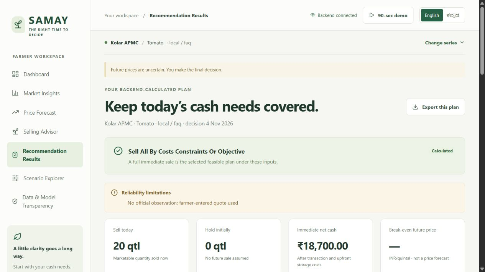
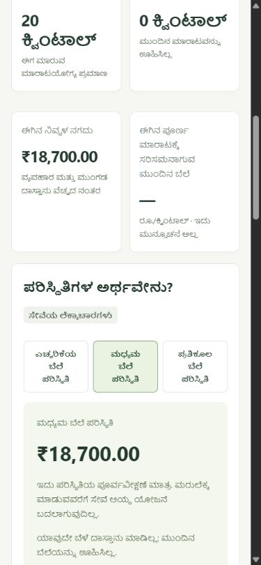

# Executed release verification · 2026-11-04

> Post-acquisition update: official acquisition/import and retrospective comparison
> have completed. Current checks: 90 backend tests, 14 frontend tests, 3 HTTP tests,
> lint/typecheck/build/migrations/pip consistency pass. Detailed current evidence:
> POST-ACQUISITION-VERIFICATION.md and MODEL-RESULTS.md. Earlier zero-data counts
> below are historical. Validated operational forecasts remain unavailable.

Windows PowerShell; Python 3.12.10, Node 24.20.0, npm 11.19.0. Working directory:
`C:\Users\Suhan\OneDrive\文件\ChatGPT\agritech\samay-agritech`.
No Docker executable was available. No external deployment was performed.

## Executed checks

The complete run is recorded at `reports/release/verification.json` with exact
argument arrays, working directories, exit codes, elapsed times and log paths.
Commands below use the repository's virtual-environment Python; frontend commands
run in `frontend/`.

| Command | Observed result | Exit |
| --- | --- | ---: |
| `.venv\Scripts\python.exe -m alembic -c backend/alembic.ini upgrade head` | Successful repeat upgrade | 0 |
| `.venv\Scripts\python.exe -m alembic -c backend/alembic.ini check` | No new upgrade operations | 0 |
| `.venv\Scripts\python.exe -m ruff check backend scripts tests` | All checks passed | 0 |
| `.venv\Scripts\python.exe -m pytest tests -q` | **82 passed**, 1 deprecation warning, 43.05s | 0 |
| `.venv\Scripts\python.exe -m pip check` | No broken requirements | 0 |
| `npm.cmd test` | **13 passed** | 0 |
| `npm.cmd run typecheck` | TypeScript successful | 0 |
| `npm.cmd run lint` | ESLint + JSX accessibility successful | 0 |
| `npm.cmd run build` | Production build successful | 0 |
| `.venv\Scripts\python.exe scripts/run_e2e.py` | **3 passed**, disposable real HTTP service | 0 |
| `npm.cmd audit --omit=dev` | 0 vulnerabilities | 0 |
| `npm.cmd audit --json` | **14 moderate**, 0 high/critical; development dependency findings | 1 |
| `.venv\Scripts\python.exe scripts/check_readiness.py` | Database initialized; official=0; fixture=3; no models; ready=false | 2 |

Production output: 2,166 transformed modules; CSS 31.56 kB (gzip 8.17 kB), JS
481.56 kB (gzip 142.53 kB). This is a browser build, not proof of cloud deployment.

The verifier intentionally fails the overall release gate when data readiness or
dependency audit remains open. `engineering_checks_pass=true`,
`authentic_demo_ready=false`. Passing engineering checks does not satisfy authentic
market forecasting acceptance.

The one warning is Starlette's deprecation of its current httpx TestClient path.
Tests still pass; future dependency maintenance should migrate when appropriate.
No warning was suppressed to make the run green.

## Local runtime checks

Executed:

```powershell
.\.venv\Scripts\python.exe scripts/start_local.py --check
# SAMAY ready: http://127.0.0.1:5173
# Swagger: http://127.0.0.1:8010/docs
.\.venv\Scripts\python.exe scripts/start_local.py --backend-port 8012 --frontend-port 5175
# SAMAY ready: http://127.0.0.1:5175
# Swagger: http://127.0.0.1:8012/docs
Invoke-RestMethod http://127.0.0.1:5175/backend/api/health
# status=ok service=samay version=0.1.0
Invoke-RestMethod http://127.0.0.1:8012/api/v1/data/status
# status=unavailable official_observations=0 fixture_observations=3
```

Fresh-port startup exercised migrations, real Vite proxy and current backend
startup checks. The test launcher cleans up only its own services with Ctrl+C.
No unrelated listeners are terminated.

The full setup command was also executed. Its first `npm ci` attempt failed with
Windows EPERM on the loaded Lightning CSS native module because Vite was running.
An early repository-process check was added and tested: it exits 1 with a clear
stop-preview message before modifying dependencies. After stopping the verified
repository Vite processes, rerunning `.venv\Scripts\python.exe scripts/setup_local.py`
exited 0: pinned Python install/local package succeeded, `npm ci` installed 363
packages, and existing environment files were preserved. Logs:
`reports/setup-local.log` (failure), `reports/setup-local-repaired.log` (success).
The installer also reports ESLint 9 and whatwg-encoding deprecation notices;
compatible toolchain upgrades remain maintenance work.
After that clean reinstall, frontend tests again passed 13/13, lint passed, the
same production assets built successfully, the real HTTP suite again passed 3/3,
and `pip check` remained clear. See `reports/reinstalled-*.log`. Fresh default-port
startup and `/backend/api/health` were checked again successfully. Agent-owned
test/startup services are stopped during final teardown; use the documented
startup command to run the app again.

In-browser, submitted labeled example inputs through FastAPI: 20 qtl, quote
₹1,000/qtl, cash need ₹10,000, capacity 0, 5% commission, ₹100 fixed trip and
₹10/qtl transport. Actual result: sell 20, hold 0, net ₹18,700; source explicitly
unavailable and no model used. Switching Kannada preserved all amounts. Reviewed
desktop and 390×844 mobile layout; Kannada voice unavailable triggered text fallback.

Screenshots (actual no-forecast example result):





## Failures found and corrected

- ESLint latest major conflicted with accessibility-plugin peers; installed
  compatible ESLint 9. A global minimatch 11 override broke callable imports;
  restored compatible dependency resolution, disclosing moderate advisories.
- Historical replay UI could submit before catalog loading, sending the wall-clock
  date. Advisor/demo now fetch backend mode before request construction. The real
  HTTP suite passes without overriding browser time.
- Initial E2E queries assumed exact source-link text/version prefix. Assertions
  now inspect actual rendered source labels and artifact version identifiers.
- Financial test assumed every later date stayed feasible after halving prices.
  Corrected it to verify explicit infeasibility and realized cash failures; no
  economic inputs/metrics were altered to improve outcomes.
- Lint findings fixed; startup checks and final same-row baseline metrics added.

## Coverage and limits

Tests cover corrupt/duplicate/revised CSV records, date/unit validation, source
integrity, causal features, late labels/revisions, holdout separation, interval
ordering/coverage math, sparse/stale/no-model paths, API error/persistence behavior,
positive/negative/flat prices, zero storage, high costs/spoilage, negative net
returns, cash infeasibility, grid conservation, deterministic ranking, language
switching, numerical consistency and scenario preview updates.

HTTP E2E uses React in jsdom with real network requests to Uvicorn and real domain
services. It is not a full automated browser engine test; actual browser review
was manual through available browser tooling. No formal accessibility certification,
load/stress/penetration test, farmer field study, authentic dataset/model evaluation,
Docker build or cloud deployment is claimed. EVALUATION preserves the real empty
data results and reproduction commands.
